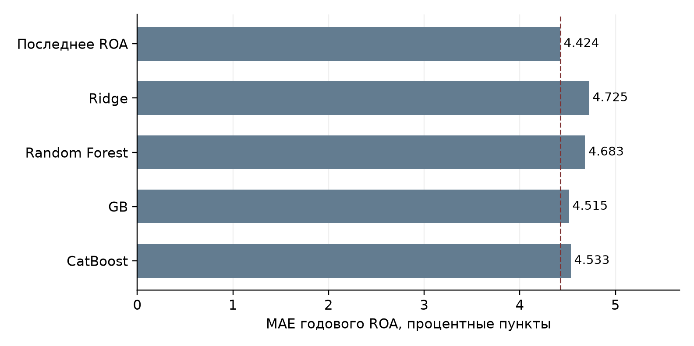

# Базовые модели

Основной годовой тест: 88 наблюдений «компания–год», 2018–2024, сценарий `main_ifrs`.

| Модель | MAE, п.п. ROA |
|---|---:|
| Последний известный ROA | 4.424 |
| Исходный Gradient Boosting без макропризнаков | 4.515 |
| Выбор модели по прошлым разбиениям | 4.457 |

Исходный GB не улучшил основной ориентир по MAE. Сравнение должно сохранять одинаковую выборку и временные разбиения, а не выбирать удачный год отдельно для каждой модели.

[Все метрики и сценарии](../results/annual/model_metrics.csv), [построчные прогнозы](../results/annual/predictions.csv), [настройки](../results/annual/selected_parameters.csv), [внутренняя проверка](../results/annual/inner_cv_results.csv).

Команда `python reproduce.py` пересчитывает метрики сохранённых прогнозов. `python reproduce.py --nested` заново выбирает настройки исходного годового пилота. Это разные уровни воспроизведения. Готовые бинарные модели в пакет не входят.
