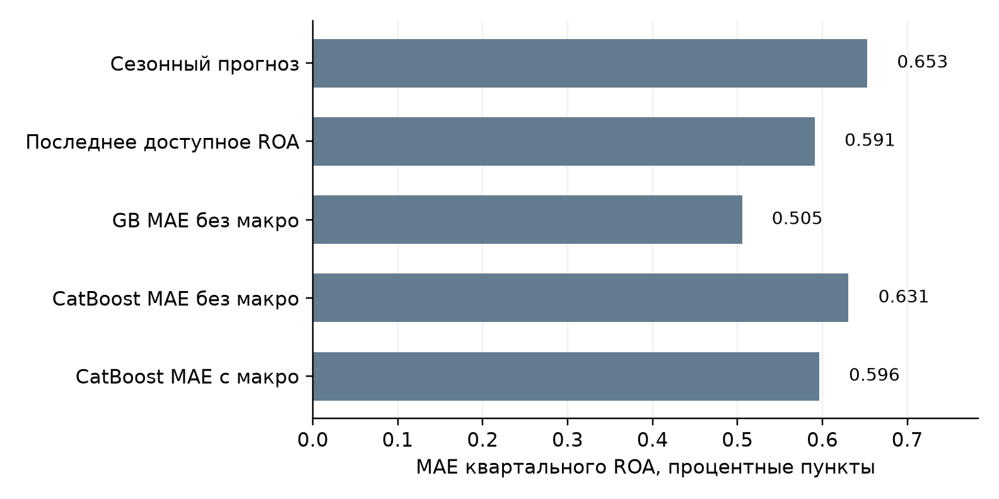

# Моделирование и дополнительные эксперименты

В календарном плане этой недели указаны pooled LSTM/GRU. Эти нейросетевые эксперименты пока не выполнены. Здесь собраны фактически выполненные последующие проверки.

## Годовые эксперименты

Проверены включение простого прогноза в выбор моделей, прогноз изменения ROA и другие функции потерь. [Протокол](../results/annual_extensions/experiment_protocol.json), [метрики](../results/annual_extensions/metrics.csv), [выбранные модели](../results/annual_extensions/selected_models.csv).

GB с абсолютной ошибкой без макропризнаков получил MAE 4.201 п.п. против 4.424 у простого прогноза (примерно 5.04% улучшения). Это результат после анализа уже просмотренного теста, поэтому он остаётся исследовательским. Автоматический выбор среди вариантов с разными потерями дал около 4.450 п.п. и не превзошёл простой прогноз.

## Квартальный пилот

Основной сценарий `main_lag2`: 3 компании, 24 тестовых наблюдения за 2024Q1–2025Q4.

| Модель | MAE, п.п. квартального ROA |
|---|---:|
| Сезонный простой прогноз | 0.653 |
| Последний доступный ROA | 0.591 |
| GB MAE без макропризнаков | 0.505 |
| CatBoost MAE без макропризнаков | 0.631 |
| CatBoost MAE с макропризнаками | 0.596 |

[Все метрики](../results/quarterly/metrics.csv), [прогнозы](../results/quarterly/predictions.csv), [протокол и ограничения доступности](../results/quarterly/protocol.json).

При условном лаге 1 последний доступный ROA даёт 0.535 п.п. и оказывается лучше GB (0.580). Поэтому преимущество зависит от сценария доступности информации. Годовой и квартальный MAE напрямую несопоставимы.

`python reproduce.py --fit` повторно обучает модели с записанными годовыми настройками и три квартальных сценария. Модели не выбираются заново по тесту.
