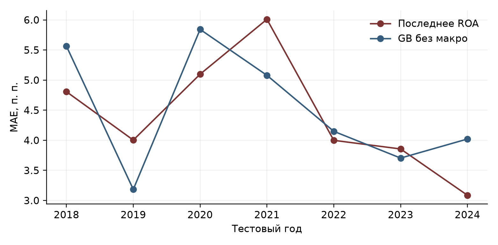

# Анализ результатов

[Ошибки по компаниям](../results/diagnostics/annual_errors_by_company.csv), [ошибки по годам](../results/diagnostics/annual_errors_by_year.csv), [крупнейшие ошибки](../results/diagnostics/annual_largest_errors.csv) получаются из сохранённых прогнозов командой `python code/analyze_results.py`.

У исходного GB без макропризнаков 10 крупнейших ошибок составляют около 38.9% суммы абсолютных ошибок; модель лучше простого прогноза в 38 из 88 случаев. Максимальная ошибка — Мангистаумунайгаз, 2020 год, около 27.22 п.п. Это повод разбирать экономические события и сопоставимость отчётности, а не автоматически удалять сложные наблюдения.

В исходном годовом эксперименте добавление макропризнаков ухудшило MAE во всех четырёх семействах. Для CatBoost с MAE в последующих экспериментах направление изменилось. Это показывает зависимость результата от модели и потерь, а не доказанный универсальный эффект макроэкономики.

[Парные сравнения макропризнаков](../results/comparisons/paired_macro_bootstrap.csv) и [квартальные сравнения](../results/quarterly/paired_bootstrap.json) используют пересэмплирование целых тестовых периодов. Интервалы описательные; зависимость соседних периодов не сохраняется. Это не интервалы будущих прогнозов.

Дальнейшие действия: восстановить даты публикации и версии отчётности; расширить квартальную панель и число периодов; заранее зафиксировать новые эксперименты; проверить перенос на новые компании; затем оценить нейросетевые и интервальные методы. Не выбирать «лучшую модель» только по минимуму ошибки на уже просмотренном тесте.
